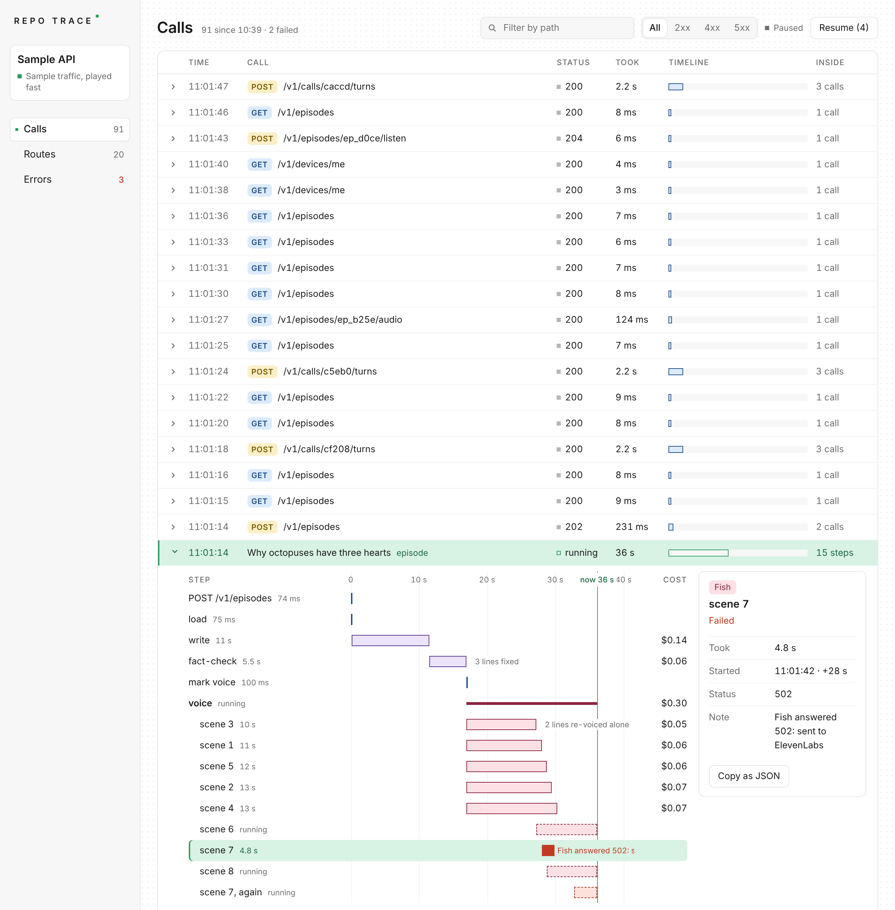

# Repo Trace

Your local API's calls as a live waterfall, instead of scrolling a terminal.



You start your API the way you always do, with `trace` in front. Repo Trace reads what it prints and draws its calls on a page on your computer: every request, what ran inside it, what failed and where, and your routes read from the code.

Part of Studio G's Repo tools, with [Repo Atlas](https://github.com/gabadou/repo-atlas): Atlas maps the code, Trace shows what ran.

Made for Cloudflare Workers first: requests are read from what `wrangler dev` prints, with nothing added to your project. Any other server works too, through the calls your app logs (below); reading Node servers' requests on their own is next.

## Install

Node 20 or later. Not on npm yet, so from GitHub:

```sh
npm install -g github:gabadou/repo-trace
```

That gives you the `trace` command. Or clone this repo and run `npm link` in it.

## Try it

```sh
trace demo --open
```

A sample API with its routes and live traffic: requests as they come (a 404 now and then, a rare 500), and podcast episodes being made, with a writer, a fact-check, scenes voiced five at a time, one that fails and goes to another voice.

## Use it

Put `trace` in front of the command you already use to start your API:

```sh
trace npm run dev          # instead of: npm run dev
trace ./dev.sh             # instead of: ./dev.sh
trace dev                  # shortcut for wrangler dev, with TRACE=1
npm run dev | trace        # or pipe it
```

The command runs in your terminal as usual: same output (minus Repo Trace's own trace lines; `--show` keeps them), same Ctrl+C. Repo Trace adds one line, `trace: calls on http://localhost:4400`, and stops when your command stops. Requests show up as they happen, with nothing added to the project. Routes are read from the project in the folder you run it from, or the one just below it (`api/`).

To keep it one word away, add a script and leave `dev` as it is:

```json
"dev:trace": "trace npm run dev"
```

Options go before the command: `--port <n>` (default 4400), `--open` to open the page. The page listens on your computer only, and it starts nothing: your terminal does.

Then log your calls. Copy `lib/trace.ts` into your app:

```ts
import { span, traceGroup, tracedFetch } from './trace';

traceGroup(episodeId, 'episode');

const script = await span('write', { group: episodeId, svc: 'claude' }, async (s) => {
  const out = await writeScript(brief);
  s.cost(out.usd);
  return out;
});

const fish = tracedFetch('scene 7', { group: episodeId, svc: 'fish', parent: voiceId });
const res = await fish('https://api.fish.audio/v1/tts', { method: 'POST', body });
```

Or print the lines yourself: the format is in [docs/format.md](docs/format.md). One finished call:

```js
console.log(JSON.stringify({ trace: 'span', group: 'ep_1', name: 'write', svc: 'claude', ms: 1200, ok: true }));
```

Requests need no logging at all: `wrangler dev` prints a line for each. Logging is for what happens inside them.

## What it doesn't do (yet)

- Keep history: the viewer holds what it has seen since it started (the last 20,000 lines).
- Watch production. Repo Trace is for the API running on your computer; Cloudflare's own logs and traces (Workers Observability) cover deployed Workers.
- Read OpenTelemetry.

## Privacy

What your app logs is what Repo Trace shows, and nothing leaves your computer. Your app's logs can still end up in production logs if tracing stays on there: turn it off in production, and log names, timings, statuses and costs, never what a user wrote, a prompt or a key.

## Develop

No dependencies. Node 20 or later.

```sh
npm test
```

MIT licence.
